# Лабораторная работа №5. Облачные базы данных — Amazon RDS

**Студент:** Yakovlev Vladyslav  
**Группа:** IA2404  
**Специальность:** Informatică aplicată (Прикладная информатика)  
**Уровень:** продвинутый (задания 1–12)  
**Проект:** TimeCapsule  
**Регион AWS:** `eu-central-1` (Frankfurt)  

## Содержание

- [Цель и исходная архитектура](#цель-и-исходная-архитектура)
- [Часть 1. Учебная база](#часть-1-учебная-база)
  - [1. Сетевое размещение](#1-сетевое-размещение)
  - [2. Создание RDS](#2-создание-rds)
  - [3. Подключение к PostgreSQL](#3-подключение-к-postgresql)
  - [4. Реплика для чтения](#4-реплика-для-чтения)
  - [5. Восстановление после удаления](#5-восстановление-после-удаления)
- [Часть 2. База TimeCapsule](#часть-2-база-timecapsule)
  - [6. Постоянный экземпляр RDS](#6-постоянный-экземпляр-rds)
  - [7. Автоматическая остановка](#7-автоматическая-остановка)
  - [8. Пользователь и база](#8-пользователь-и-база)
  - [9. Миграция данных](#9-миграция-данных)
  - [10. Переключение приложения](#10-переключение-приложения)
  - [11. Обслуживание и события](#11-обслуживание-и-события)
  - [12. Архитектурное решение](#12-архитектурное-решение)
- [Контрольные вопросы](#контрольные-вопросы)
- [Итоги и ограничения доказательств](#итоги-и-ограничения-доказательств)

## Цель и исходная архитектура

Цель лабораторной работы — освоить приватное размещение PostgreSQL в Amazon RDS, ограничения доступа Security Groups, репликацию чтения, восстановление Point-in-Time Recovery (PITR), а затем перенести базу приложения TimeCapsule с PostgreSQL на EC2 в управляемую RDS. Дополнительно требуется сократить расходы за счёт расписания остановки экземпляра.

В лабораторных №3–4 приложение находилось на `app-server` (EC2), PostgreSQL — на отдельном `db-server` (EC2), вложения — в приватном S3. Сеть использует VPC `10.27.0.0/16`, приватные подсети `private-a` (`10.27.10.0/24`) и `private-b` (`10.27.11.0/24`). В части 2 прежняя EC2-база заменяется на RDS, а доменное имя `db.timecapsule.internal` сохраняется благодаря Route 53 CNAME.

Постоянные ресурсы используют имена с префиксом `timecapsule-dev-`; временные учебные — `lab5-`. В применимых ресурсах использовались теги `Name`, `Project=timecapsule`, `Environment=dev`, `Owner=vladyslav-yakovlev`, `Lab=lab5`.

## Часть 1. Учебная база

### 1. Сетевое размещение

Создана группа подсетей `lab5-db-subnets`, включающая две приватные подсети в разных зонах доступности: `eu-central-1a` и `eu-central-1b`. Для клиента EC2 использована `lab5-web-sg`, для PostgreSQL — `lab5-rds-sg`, разрешающая входящий TCP 5432 от Security Group клиента. Ссылка на SG предпочтительнее фиксированного IP при замене или пересоздании экземпляра EC2.

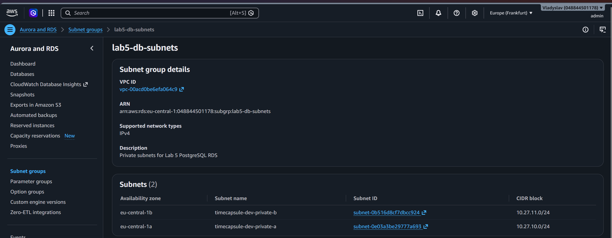

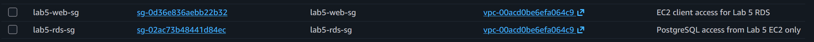

**Результат:** назначены допустимые зоны размещения RDS и ограничен источник входящих соединений PostgreSQL. Две AZ в subnet group не означают, что сам экземпляр автоматически становится Multi-AZ.

### 2. Создание RDS

Создан учебный экземпляр `lab5-db`: PostgreSQL, Single-AZ, класс `db.t4g.micro`, 20 GiB `gp3`, без публичного доступа. Основной пользователь — `dbadmin`, начальная база — `lab5`, размещение — через `lab5-db-subnets` и `lab5-rds-sg`. Шифрование хранилища и защита от удаления были предусмотрены при настройке экземпляра.

**Фактически на скриншоте подтверждено:** Automated backups = **Enabled (1 Day)**, а не 7 дней из методички. Однодневного окна было достаточно для учебного PITR, но этот выбор отличается от формального требования задания.

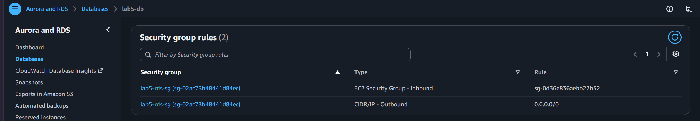

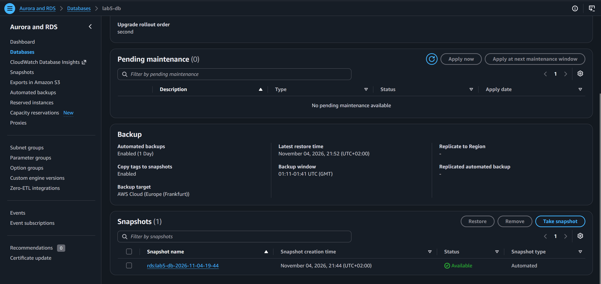

### 3. Подключение к PostgreSQL

Подключение выполнялось с `app-server` через приватный RDS endpoint:

```bash
psql -h "$RDS_HOST" -U dbadmin -d lab5
```

Проверены `SELECT version();` и `\conninfo`; соединение использовало TLS. Создана таблица `notes`:

```sql
CREATE TABLE notes (
  id SERIAL PRIMARY KEY,
  body VARCHAR(100) NOT NULL,
  created_at TIMESTAMPTZ NOT NULL DEFAULT now()
);
INSERT INTO notes (body) VALUES ('first'), ('second'), ('third');
SELECT * FROM notes;
```

Записи `first`, `second`, `third` присутствуют на скриншоте. Имя endpoint разрешалось внутри VPC в приватный IP. На локальном Windows-компьютере также выполнен DNS-запрос; получение IP-адреса через DNS само по себе не означает доступности порта 5432 снаружи.

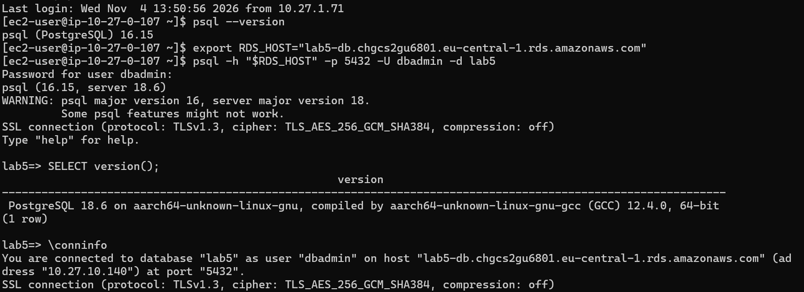

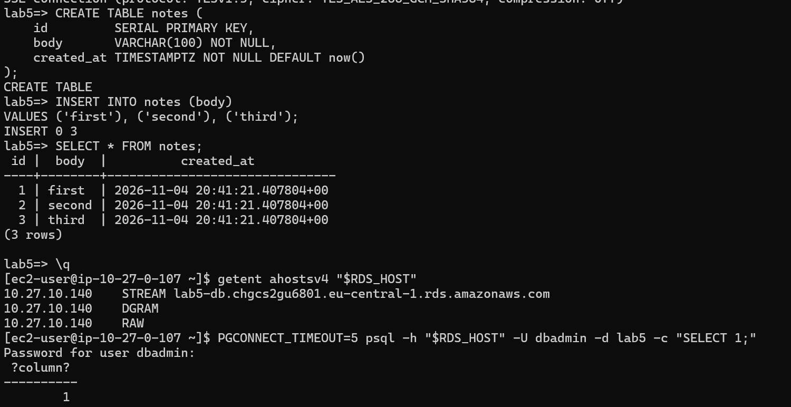

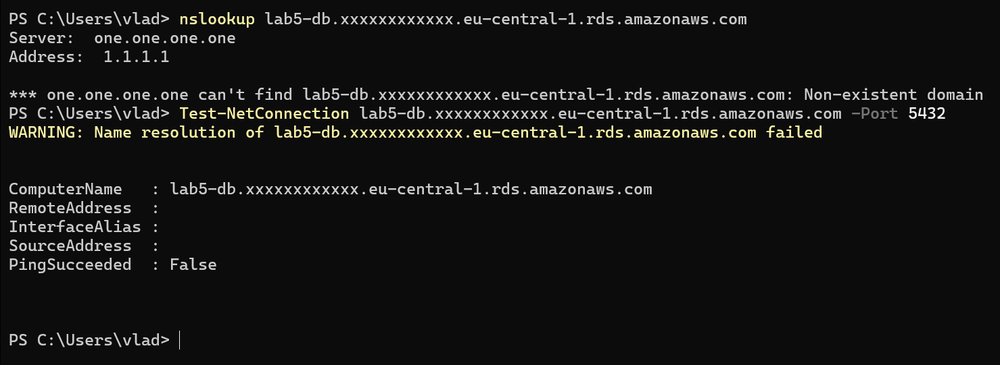

### 4. Реплика для чтения

Создана `lab5-db-replica` в `eu-central-1b` с отдельным endpoint. На реплике `SELECT pg_is_in_recovery()` возвращал `true`; запрос на чтение таблицы `notes` прошёл, а попытка `INSERT` завершилась ошибкой read-only transaction. На основной базе `pg_is_in_recovery()` возвращал `false`; после добавления строки `fourth` она появилась при чтении на реплике.

```sql
SELECT pg_is_in_recovery();
SELECT * FROM notes;
INSERT INTO notes (body) VALUES ('from replica');
```

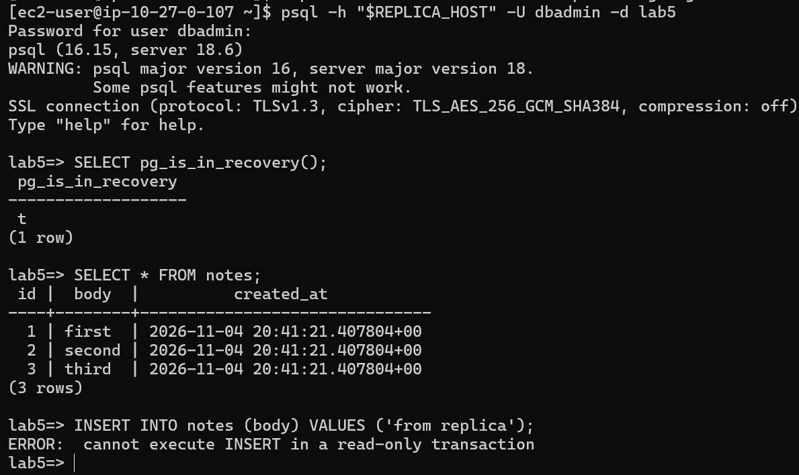

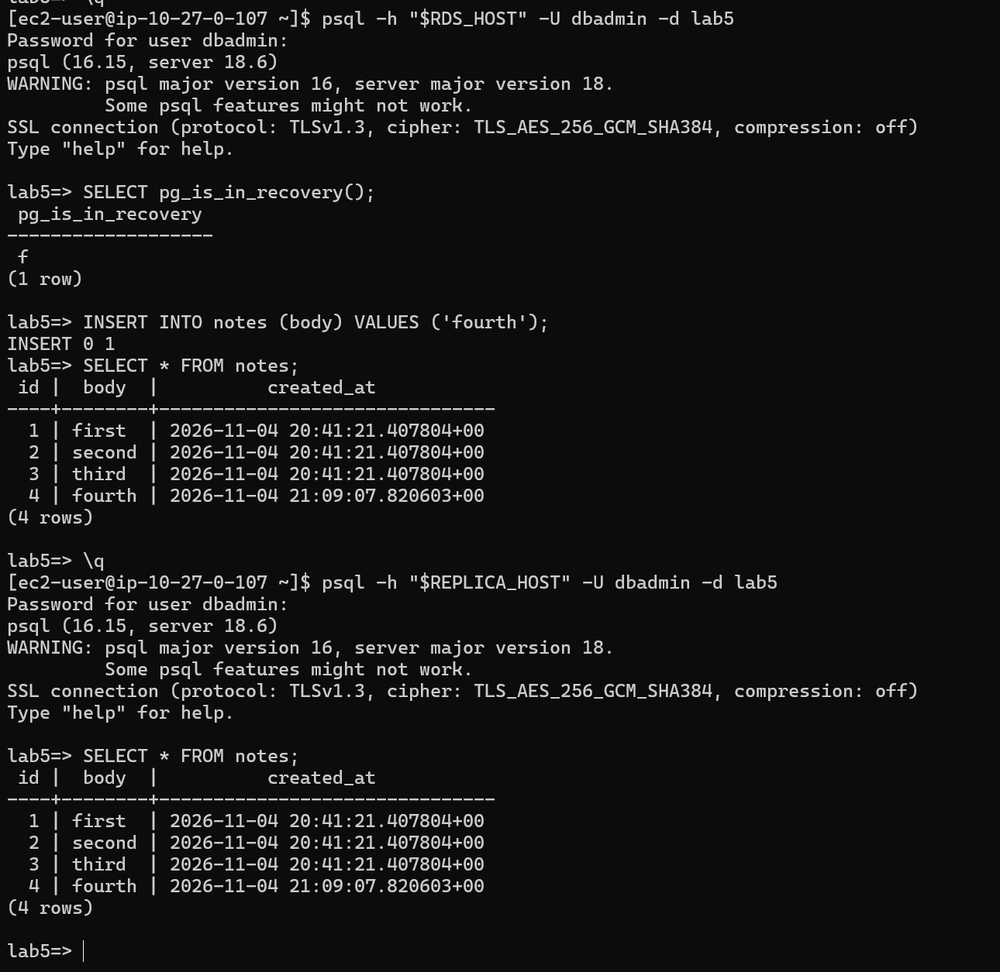

В AWS исследован мониторинг реплики. **Замечание по доказательству:** изображение ниже содержит график `ReadLatency`, а не саму метрику `ReplicaLag`; поэтому численное значение отставания по нему не устанавливается.

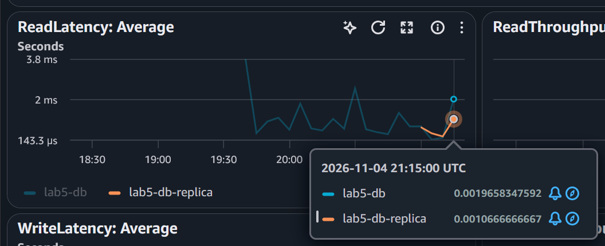

### 5. Восстановление после удаления

Перед удалением было зафиксировано UTC-время восстановления, а в таблице `notes` находились четыре записи. Затем на основной базе выполнено `DELETE FROM notes;`, после чего `SELECT` вернул ноль строк. Та же пустая таблица наблюдалась на реплике: операция удаления тоже реплицировалась.

```sql
SELECT now() AT TIME ZONE 'UTC';
DELETE FROM notes;
SELECT * FROM notes;
```

После удаления реплики выполнено восстановление на момент до удаления в отдельный экземпляр `lab5-db-restore`. В восстановленной таблице `notes` снова были **все четыре записи**. Таким образом, PITR позволил восстановить прошлое состояние, не откатывая работающий исходный экземпляр.

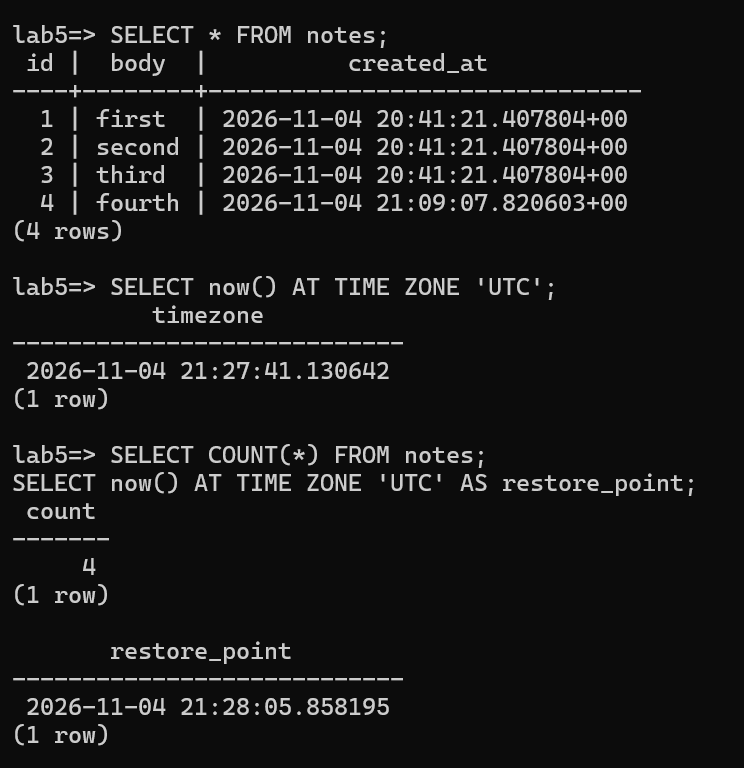

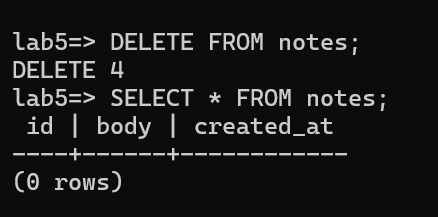

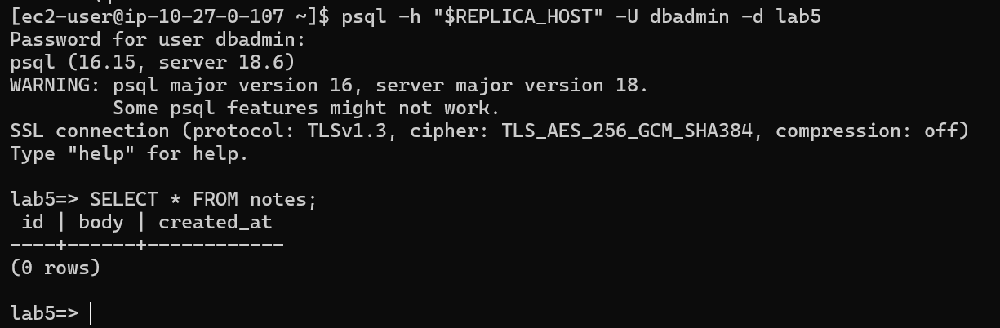

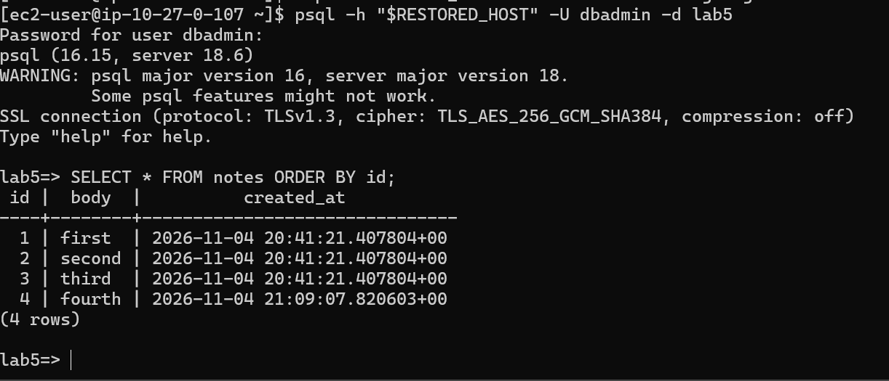

После учебного эксперимента временные экземпляры и сетевые ресурсы `lab5-*` подлежали удалению. Отдельного скриншота списка ресурсов после очистки в архиве нет.

## Часть 2. База TimeCapsule

### 6. Постоянный экземпляр RDS

Для приложения создана DB Subnet Group `timecapsule-dev-db-subnets` с двумя приватными подсетями. Для экземпляра `timecapsule-dev-rds` настроена `timecapsule-dev-rds-sg` с разрешением TCP 5432 только от группы приложения, без публичного доступа. Выбрана конфигурация Single-AZ; начальное имя базы не задавалось, поскольку схема и пользователь создавались отдельно.

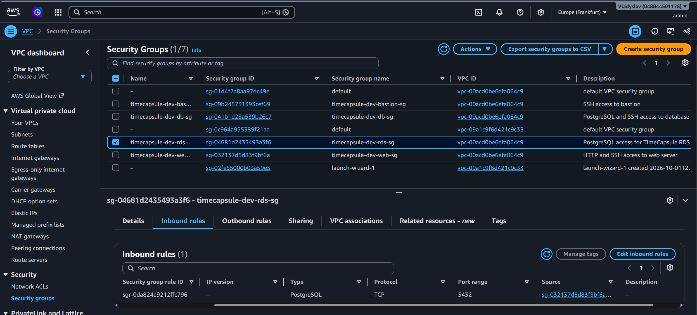

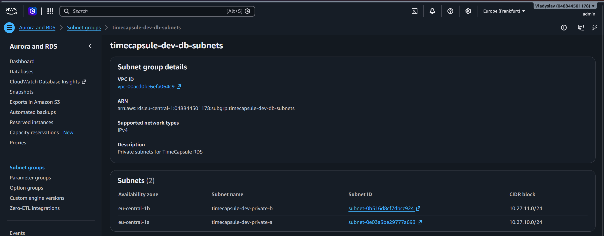

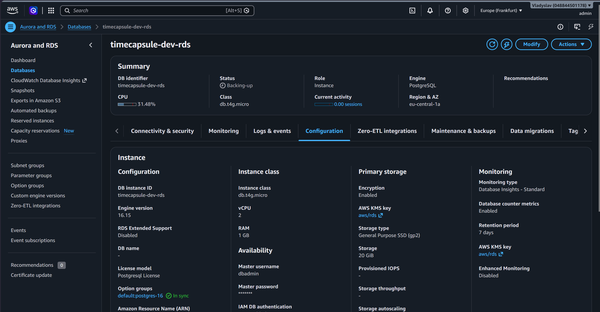

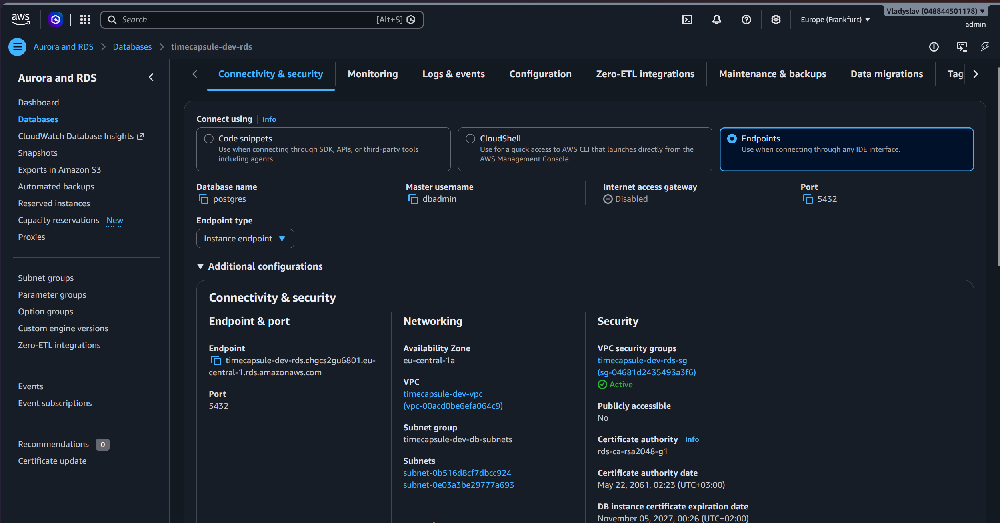

В production вместо Single-AZ оправдано рассмотреть Multi-AZ, более длительное хранение резервных копий, мониторинг, сертификатную проверку TLS и формализованные RPO/RTO. В текущем dev-окружении приоритет отдан экономии.

### 7. Автоматическая остановка

Для ежедневной остановки экземпляра подготовлены:

- IAM policy `timecapsule-dev-rds-stop`, разрешающая `rds:StopDBInstance` для ARN только `timecapsule-dev-rds`;
- IAM role `timecapsule-dev-scheduler-role` с доверенным сервисом `scheduler.amazonaws.com`;
- EventBridge Scheduler `timecapsule-dev-rds-nightly-stop`, cron `0 23 * * ? *`, timezone `Europe/Chisinau`, flexible time window `Off`.

Вызов API использует параметр `DbInstanceIdentifier = timecapsule-dev-rds`. Назначение отдельной роли позволяет не использовать статические ключи доступа и ограничить действие единственным экземпляром. Следы вызова API дополнительно видны в CloudTrail (задание 11).

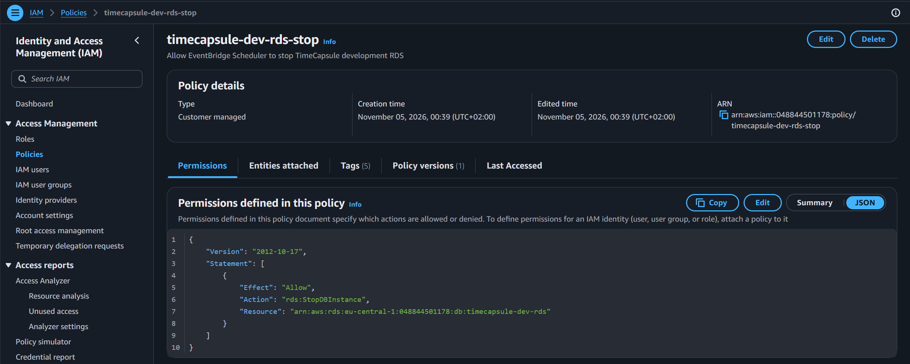

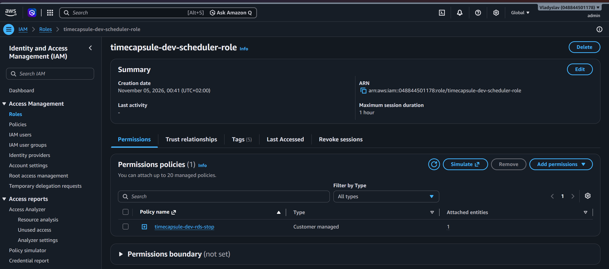

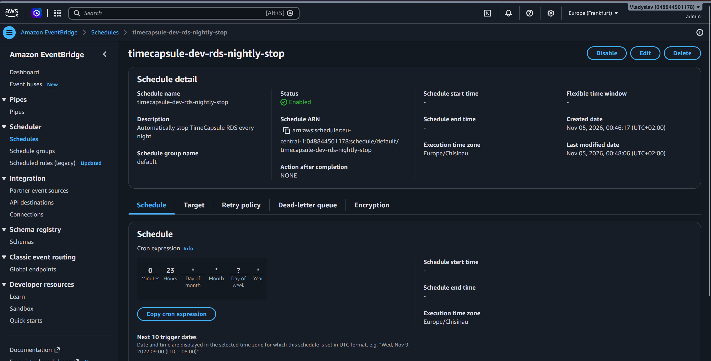

### 8. Пользователь и база

Административное подключение выполнялось к служебной базе `postgres` от имени `dbadmin`. Для приложения созданы отдельная роль и база:

```sql
CREATE USER timecapsule;
\password timecapsule
GRANT timecapsule TO dbadmin;
CREATE DATABASE timecapsule OWNER timecapsule;
```

`\password` исключает запись пароля в истории SQL-команд. Членство `dbadmin` в роли `timecapsule` требуется для передачи владения создаваемой базой, поскольку администратор RDS не является обычным полным суперпользователем PostgreSQL. После создания выполнены `\du`, `\l` и подключение под `timecapsule`; запрос показал `current_user = timecapsule` и `current_database = timecapsule`. На скриншоте также показано TLS-соединение.

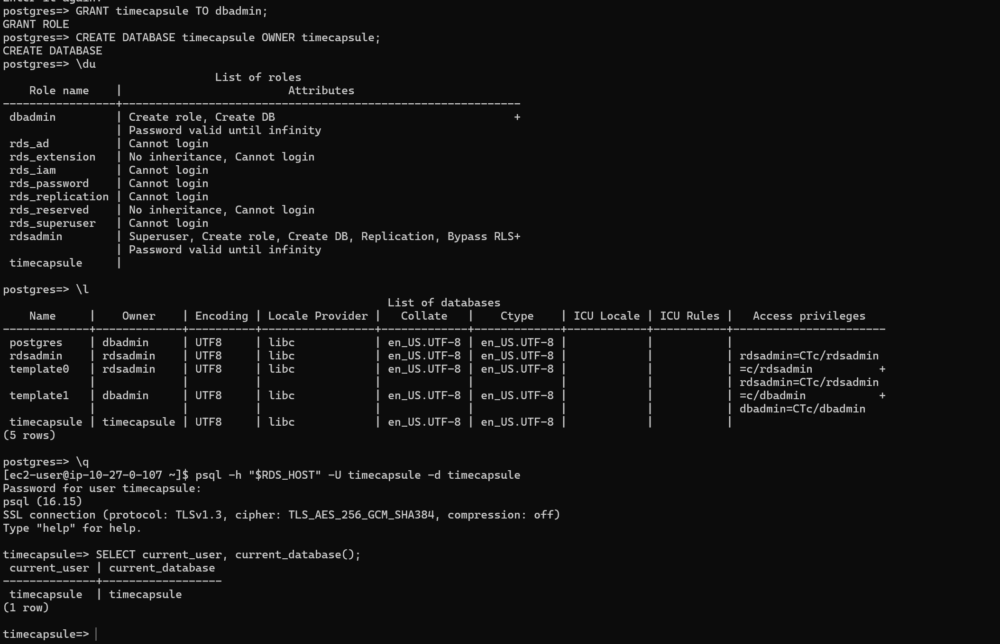

### 9. Миграция данных

Со старой PostgreSQL на EC2 создан SQL-дамп, исключающий команды смены владельца и выдачи прав:

```bash
pg_dump -h db.timecapsule.internal -U timecapsule -d timecapsule \
  --no-owner --no-privileges -f timecapsule.sql
```

Импорт выполнялся на новой RDS под пользователем `timecapsule`:

```bash
psql -h "$RDS_HOST" -U timecapsule -d timecapsule -f timecapsule.sql
```

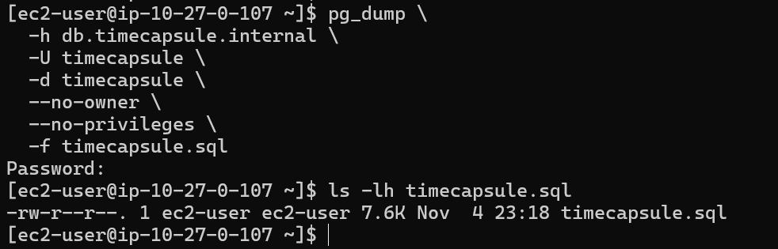

Для проверки выполнены `COUNT(*)` в таблицах `users` и `capsules` на обоих экземплярах.

| Таблица | Старый `db-server` | RDS `timecapsule-dev-rds` | Совпало |
|---|---:|---:|:---:|
| `users` | 2 | 2 | Да |
| `capsules` | 3 | 3 | Да |

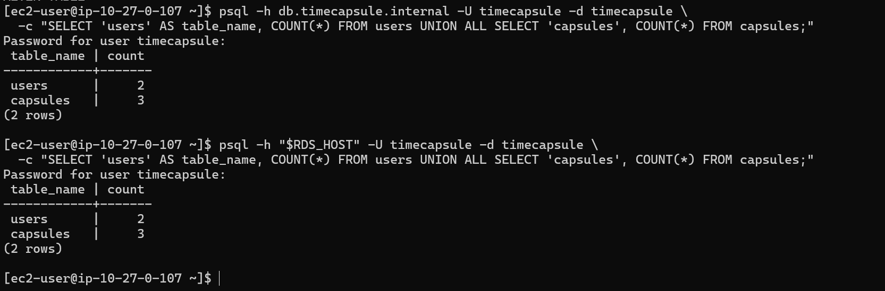

Для защиты персональных данных SQL-выгрузка после проверки должна быть удалена с `app-server`; сам дамп в отчёт не включён.

### 10. Переключение приложения

В приватной Hosted Zone `timecapsule.internal` запись `db.timecapsule.internal` была заменена с `A` (IP прежнего `db-server`) на `CNAME` (DNS endpoint `timecapsule-dev-rds`). Приложение продолжило использовать прежнее значение `DB_HOST`, без привязки к конкретному IP-адресу. DNS CNAME также был подтверждён командой `dig` на `app-server`.

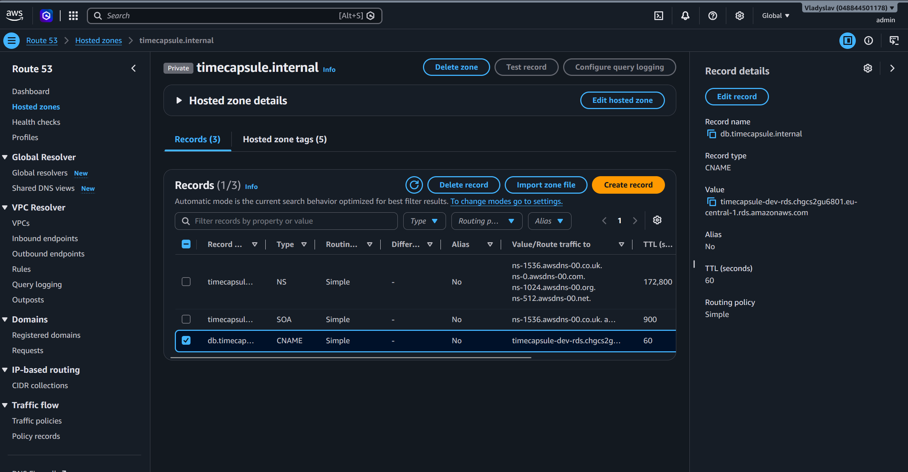

После переключения в интерфейсе TimeCapsule создана тестовая капсула **RDS Migration Test**, запись обнаружена в таблице `capsules` на новой RDS. Это подтверждает, что приложение выполняет запись через обновлённое подключение к базе.

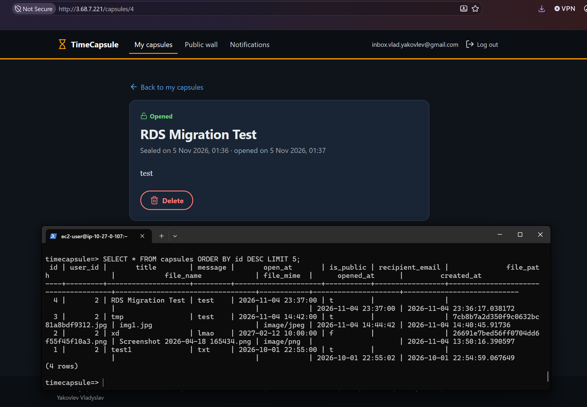

По завершении проверки старый EC2 `db-server` стал не нужен и по процедуре задания подлежал остановке и удалению. Отдельного скриншота списка EC2 после удаления в предоставленном архиве нет; поэтому факт окончательного удаления не подтверждается приложенным изображением.

### 11. Обслуживание и события

Экземпляр `timecapsule-dev-rds` перезагружался несколько раз. В RDS `Logs & events` видны события жизненного цикла экземпляра. Пользователь проверял поведение `/health` при недоступной базе и сообщил, что endpoint возвращал **предусмотренный приложением HTTP-статус**. Точное числовое значение кода не фиксировалось; по этой причине в отчёте оно не приводится. После восстановления RDS проверка доступности снова работала ожидаемым образом.

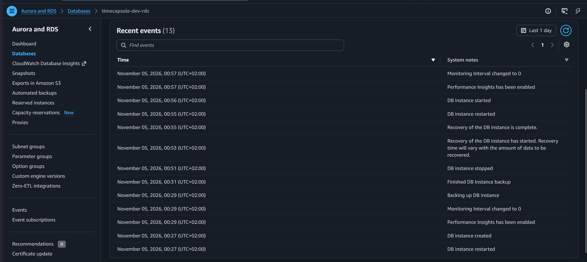

Для анализа остановки изучен `StopDBInstance` в CloudTrail. В отличие от событий состояния RDS, CloudTrail позволяет исследовать сам вызов AWS API и его инициатора.

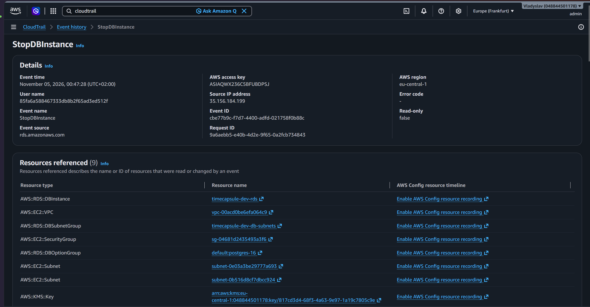

У RDS Single-AZ нет автоматического резервного экземпляра в другой AZ; во время перезагрузки или остановки соединения с PostgreSQL могут прерываться. После запуска экземпляра клиент продолжает использовать прежнее DNS-имя.

### 12. Архитектурное решение

Архитектура обновлена с учётом миграции БД на Amazon RDS. Сохранены app-server, Bastion, IAM Role приложения, приватный S3 bucket и двухзонная структура VPC. Вместо `db-server` используется приватная RDS Single-AZ в `eu-central-1a`; private-b остаётся в составе subnet group, но это не резервный работающий экземпляр. Route 53 обеспечивает стабильное имя БД, а EventBridge Scheduler — ежедневную остановку.

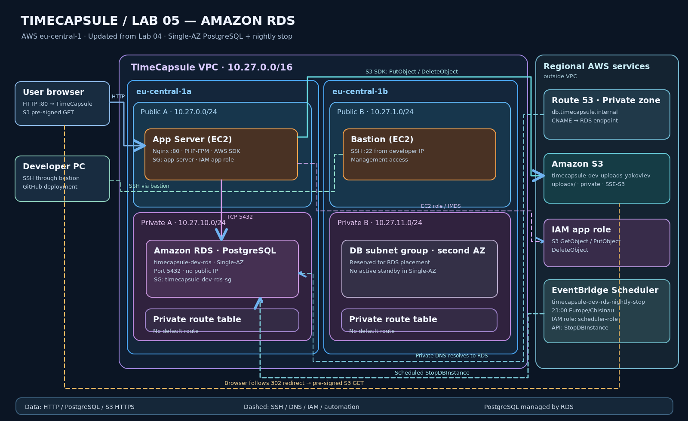

Редактируемая версия: [`timecapsule_lab5_architecture.svg`](timecapsule_lab5_architecture.svg). Архитектурное решение: [ADR-0004 — Database hosting](0004-database-hosting.md).

В ADR сравниваются PostgreSQL на EC2, RDS PostgreSQL Single-AZ, RDS Multi-AZ и Amazon Aurora; выбран Single-AZ для учебного dev-окружения. Рассмотрены резервное копирование и окно PITR, затраты на инстанс и дисковое пространство, автоматический запуск RDS после семи дней остановки, роль DNS CNAME и последствия отказа `eu-central-1a`.

## Контрольные вопросы

**1. Почему источником в правилах SG удобнее указать другую Security Group, а не IP?**  
Потому что привязка делается к разрешённым сетевым интерфейсам, а не к конкретному адресу, который может измениться после пересоздания EC2. При этом разрешения всех SG, назначенных интерфейсу, суммируются.

**2. Почему указываем две подсети, если база размещена в одной AZ?**  
Subnet group должна покрывать несколько зон доступности для типового развёртывания RDS. Но в режиме Single-AZ база работает в одной зоне; добавление второй подсети само по себе не включает failover.

**3. Как проверить, что RDS принимает соединения только от разрешённого сервера?**  
Проверить SG самой RDS, отключённый Public access и успешное подключение с `app-server`. Из недоверенной сети подключение на TCP 5432 должно быть недоступно. DNS-резолвинг приватного адреса не доказывает доступность SQL-сервера.

**4. Почему выбрана `eu-central-1a`, и что защищает deletion protection?**  
Она соответствует выбранной зоне приватной подсети и размещению учебного Single-AZ экземпляра. Deletion protection препятствует случайному удалению экземпляра RDS через штатный API, но не защищает от выполнения `DELETE`, повреждения данных или сбоев приложения.

**5. Почему `INSERT` на Read Replica не выполняется?**  
Read Replica применяет изменения исходной базы и находится в режиме только для чтения. На ней разрешены `SELECT`, но обычные пользовательские операции записи блокируются PostgreSQL.

**6. Чем Read Replica отличается от Multi-AZ?**  
Read Replica обычно применяется для разгрузки операций чтения и имеет отдельный endpoint. Multi-AZ предназначен для отказоустойчивости и обеспечивает резервное размещение с управляемым переключением; обычная реплика для чтения не равна standby-экземпляру Multi-AZ.

**7. Почему реплика не спасла после ошибочного удаления?**  
Реплика воспроизводит и корректные, и ошибочные изменения основной базы. `DELETE FROM notes` прошёл на основном экземпляре и затем отразился на реплике, поэтому необходимы независимые резервные копии/PITR.

**8. Почему PITR создаёт новый экземпляр?**  
Восстановление RDS создаёт независимую базу в выбранном состоянии, не изменяя исходную. Это позволяет проверить данные и управляемо перевести клиентов на восстановленную копию при необходимости.

**9. Что изменить для production?**  
Рассмотреть Multi-AZ, проверку TLS-сертификатов, расширенный мониторинг, резервные копии с требуемым retention, централизованное хранение секретов и тестирование восстановления. Конфигурация зависит от требований доступности и допустимой потери данных.

**10. Зачем приложению отдельный пользователь?**  
Сервису не нужны административные права `dbadmin`. Отдельный пользователь с правами на собственную БД уменьшает последствия утечки пароля, SQL-инъекций или ошибок приложения.

**11. Зачем Scheduler собственная IAM Role и ограничение по ARN?**  
Scheduler исполняет API-вызовы автоматически от доверенной роли. Политика с конкретным ARN ограничивает `StopDBInstance` только базой `timecapsule-dev-rds`, реализуя least privilege.

**12. Какой путь проходит запрос от браузера до базы?**  
Браузер обращается к приложению на EC2, затем серверное приложение по DNS `db.timecapsule.internal` получает адрес RDS через приватную Route 53 Hosted Zone. TCP-подключение проверяется Security Groups, а на уровне PostgreSQL — TLS, имя пользователя, пароль и SQL-права.

**13. Почему `DB_HOST` не пришлось менять?**  
В приложении использовалось стабильное DNS-имя, а не адрес конкретного EC2. Обновление A → CNAME в Route 53 перевело новое разрешение имени на endpoint RDS без изменения конфигурации `DB_HOST`.

**14. Какие обязанности перешли AWS, а какие остались у команды?**  
AWS обеспечивает управляемый экземпляр и штатные механизмы обслуживания и автоматических резервных копий. Команда отвечает за модель данных, права, конфигурацию доступа, мониторинг, стоимость, тестирование восстановления, а также поведение приложения при недоступности БД.

**15. Что происходило с `/health` при перезагрузке?**  
При недоступной базе endpoint возвращал предусмотренный приложением статус, а после возвращения PostgreSQL в работоспособное состояние восстановил ожидаемое поведение. Точный числовой код в предоставленных материалах не зафиксирован.

**16. Меняется ли endpoint после остановки и запуска?**  
Адрес endpoint экземпляра RDS сохраняется. Сетевые соединения при остановке разрываются, но после запуска новые соединения могут использовать прежнее DNS-имя.

**17. Что будет, если Scheduler попытается остановить уже остановленную базу?**  
Вызов `StopDBInstance` для несовместимого текущего состояния может вернуть `InvalidDBInstanceState`. Это ошибка жизненного цикла операции, а не признак повреждения данных.

**18. Сколько данных можно потерять и как часто сохраняются резервные копии?**  
PITR опирается на автоматические резервные копии и журналы транзакций, которые RDS периодически отправляет в хранилище (как правило, примерно каждые пять минут). Доступная последняя точка восстановления может отставать от текущего момента: это не строгая гарантия RPO. У временной базы на скриншоте retention = 1 день; для постоянной базы целевое значение методички — 7 дней, но фактическое значение не подтверждено предоставленным снимком.

**19. Как ограничиваются расходы и что происходит через семь дней остановки?**  
По оценке методички при примерно трёх часах работы в день и 20 GiB `gp3` расходы составляют порядка $13–14 за три месяца (оценка октября 2026 года, не актуальный счёт). Вычислительные часы сокращаются ежедневной остановкой в 23:00; хранилище оплачивается даже в остановленном состоянии. Через семь дней остановки RDS автоматически запустится и расписание сможет снова остановить его при следующем срабатывании.

**20. Что будет при отказе `eu-central-1a`?**  
Single-AZ RDS может оказаться недоступной до восстановления инфраструктуры или данных. Наличие `private-b` в subnet group не гарантирует автоматическое переключение: для этого нужна конфигурация высокой доступности, например Multi-AZ, с большей стоимостью.

## Итоги и ограничения доказательств

В рамках работы создана приватная учебная RDS, проверены SQL-подключение, чтение реплики и восстановление после удаления. База TimeCapsule перенесена в отдельную RDS; совпадение числа пользователей и капсул подтверждено запросами (`2/2` и `3/3`), CNAME переключён на endpoint RDS, а создание тестовой капсулы подтверждает запись через приложение. Настроены IAM Role и расписание остановки экземпляра, изучены события RDS и CloudTrail, подготовлена новая архитектура и ADR-0004.

**Ограничения подтверждения:** (1) для `lab5-db` подтверждён retention 1 день вместо 7; (2) график, сохранённый как `chapter4_replica-lag.png`, фактически отображает `ReadLatency`, поэтому значение `ReplicaLag` не документировано; (3) форма PITR и скриншоты окончательного удаления временных ресурсов/старого EC2 не представлены; (4) конкретный HTTP-код `/health` при отказе базы не записан; (5) срок хранения резервных копий постоянной RDS следует дополнительно проверить в консоли. Эти замечания не отменяют результатов, непосредственно подтверждённых скриншотами.

В конце работы `timecapsule-dev-rds` следует остановить вручную, а ресурсы постоянной части оставить для последующих лабораторных работ.
